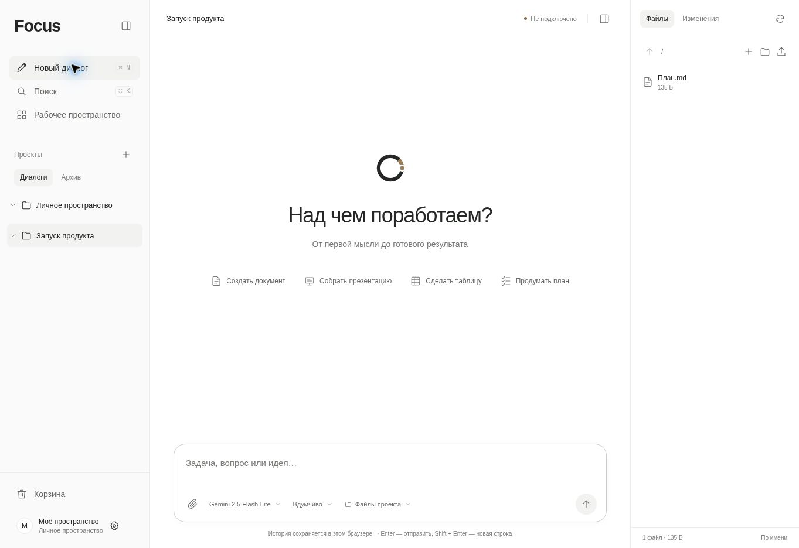

# Focus

Focus помогает сверять таблицы, проверять расчёты и работать с документами с ИИ.



1. **Сверьте выгрузки.** Загрузите две таблицы CSV или XLSX, укажите ключ и скачайте список отличий.
2. **Найдите ответ в документе.** Добавьте файл к диалогу и попросите указать условие, на котором основан ответ.
3. **Проверьте расчёт.** Введите `(125 + 18) * 1,2` в калькуляторе. Результат — 171,6.

После запуска откройте `/examples.html` для готовых примеров или `/tools.html` для своих данных.

## Быстрый старт

Понадобится Node.js 22 с поддержкой `node:sqlite` и SQLite backup API. У приложения нет npm-зависимостей для работы.

```bash
npm run build
npm test
npm run validate
npm start
```

После запуска откройте адрес из вывода сервера. Для чата и других API настройте вход по почте. Для внешних запросов дополнительно настройте провайдера, бюджет и HTTPS в рабочей установке. Пример переменных находится в [`.env.example`](.env.example).

## Ограничения

История и файлы по умолчанию хранятся в браузере. Облачная копия включается отдельно и ограничена 8 МБ. Focus рассчитан на один активный серверный процесс. Обновление требует перезапуска.

Код из ответа можно сохранить или скачать после проверки. HTML запускается в изолированном предпросмотре. Обычный чат не запускает команды сервера.

## Документация

- [Возможности](docs/features.md)
- [Архитектура](docs/architecture.md)
- [Эксплуатация](docs/operations.md)
- [Безопасность](docs/security.md)
- [Развёртывание](deploy/README.md)
- [Сообщение об уязвимости](SECURITY.md)
- [Список изменений](CHANGELOG.md)

## Лицензия

Код Focus распространяется по [MIT](LICENSE). Highlight.js сохраняет лицензию BSD-3-Clause, архивы сторонних навыков — лицензии, включённые в соответствующие архивы. Атрибуция Unslop доступна на странице «О проекте».
